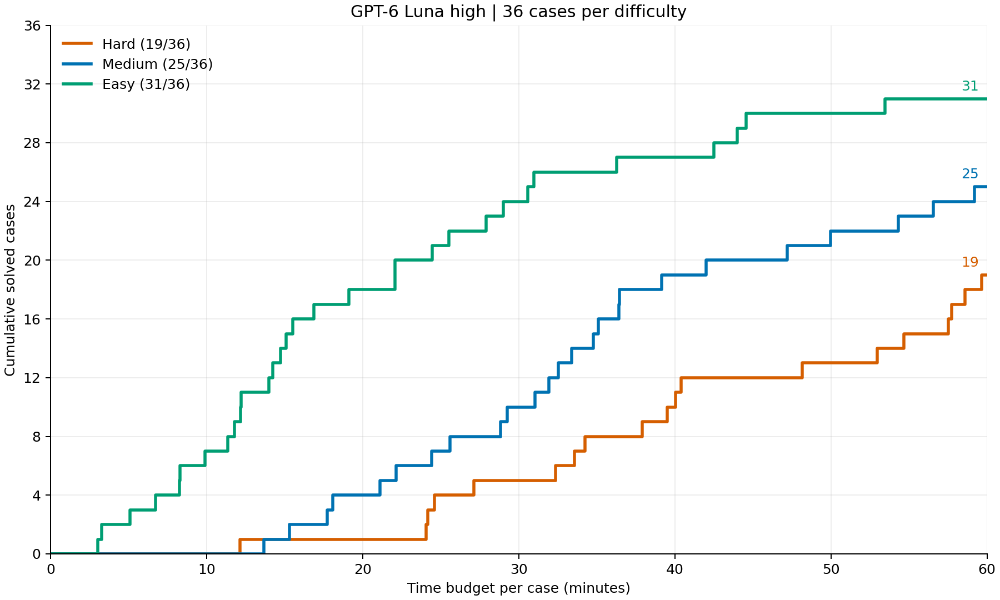

# AI Denotation Agent：研究计划文档

用 AI Agent 自动构造 Type Denotation / Logical Relation（及其推广到 abstract machine 等一般 PL 语义工作）的研究计划。
文档拆分为 **Benchmark**（近期，南京大学张子豪负责）与 **Solution**（后续探索，周喆负责）两部分。

## 目录结构

```
DenotationAgent/
├── main.tex                          # 主文档（中文，ctexart，xelatex 编译）
├── sections/
│   ├── 01-core-idea.tex              # 核心想法与定位
│   ├── 02-background.tex             # 背景与动机
│   ├── 03-benchmark.tex              # Benchmark：任务集定义（张子豪）
│   ├── 04-solution.tex               # Solution：Agent 系统与科学问题
│   └── 05-roadmap.tex                # 路线图、分工、与北大数院合作
├── bibliography.bib                  # 参考文献
├── docs/
│   ├── benchmark-proposal-2026-08.md # 重写后的沟通稿（可直接转发给张子豪）
│   └── original-idea-2026-07-27.md   # 原始想法 md（存档）
└── README.md
```

## 编译

```bash
xelatex main.tex
bibtex main
xelatex main.tex
xelatex main.tex
```

或一行：

```bash
latexmk -xelatex main.tex
```

## 主要内容

- **核心想法**：让 AI Agent 自动构造 PL 论文中最关键的语义不变量（type denotation / term denotation / logical relation / semantic domain），而非仅写 proof script。
- **Benchmark（§3）**：统一问题卡片格式；三类类型系统任务（复现 / 迁移 / 补全）；推广到 abstract machine 线（AAM、ADI、refocusing、refunctionalization、ICFP'26 staged evaluator pearl）；P0–P3 优先级；交付物四件套；里程碑。
- **Solution（§4）**：Agent 迭代工作流（candidate denotation → 逐条证明 → 失败分析 → 修改）；关键技术挑战；证明框架负担比较的科学问题。
- **路线图（§5）**：阶段 0–3 分工，以及与北京大学数学科学学院的远期合作。

## 实验结果

### 新难度标准：GPT-6 Luna high

每个难度36题，每题预算60分钟，并行100；未完成时续接原会话，共用剩余预算。本轮 Hard 成功 **19/36**，Medium **25/36**，Easy **31/36**。



横轴为每题耗时（分钟），纵轴为在该时间内累计证明成功的题数。结果 tag：`gpt6luna_high_difficulty_v4_full_r1`。

### 历史实验

- [GPT-6 Sol High 结果与失败分析](docs/gpt6sol-high-results.md)

## Benchmark Cases表

`N` = Normalization，`P` = Parametricity，`RS` = Refinement cases（当前目标为 Type Safety，沿用原列名），`NI` = Noninterference；`✔` = case 已制作完成，空白 = 未提供。

| 难度 | 提供的内容 | 需要完成 |
|---|---|---|
| Hard | 语言定义、目标定理陈述 | 自行构造 LR 和辅助证明，证明目标 |
| Medium | Hard + 已证明的基础辅助引理（新鲜变量、环境查找、局部封闭、值、归约组合等） | 自行构造 LR，完成其余辅助证明、fundamental theorem 和目标 |
| Easy | Medium + 替换、类型、求值等辅助证明 + 参考 LR、语义环境及基本性质 | 证明核心语义分支、fundamental theorem 和目标；允许采用其他 LR |

Easy 中的 fundamental theorem 陈述仅作为注释提示，不提供证明；唯一待完成的定理是目标定理。三个难度的信息逐层包含，目标定理保持一致。

完整运行108个 cases：`bash scripts/run_test.sh`。默认 GPT-6 Luna high、每题3600秒、并行100；提前结束但未通过检查时续接原会话，共用剩余预算。新结果使用 tag `gpt6luna_high_difficulty_v4_full_r1`，保留历史结果。输入及已提供引理清单见 [difficulty-manifest.json](benchmarks/difficulty-manifest.json)。

| Feature | STLC-N-Hard | STLC-N-Medium | STLC-N-Easy | SystemF-N-Hard | SystemF-N-Medium | SystemF-N-Easy | SystemF-P-Hard | SystemF-P-Medium | SystemF-P-Easy | SystemF-RS-Hard | SystemF-RS-Medium | SystemF-RS-Easy | Security-NI-Hard | Security-NI-Medium | Security-NI-Easy |
|---|---|---|---|---|---|---|---|---|---|---|---|---|---|---|---|
| None | [✔](benchmarks/stlc-normalization-none-hard) | [✔](benchmarks/stlc-normalization-none-medium) | [✔](benchmarks/stlc-normalization-none-easy) | [✔](benchmarks/systemf-normalization-none-hard) | [✔](benchmarks/systemf-normalization-none-medium) | [✔](benchmarks/systemf-normalization-none-easy) | [✔](benchmarks/systemf-parametricity-none-hard) | [✔](benchmarks/systemf-parametricity-none-medium) | [✔](benchmarks/systemf-parametricity-none-easy) | [✔](benchmarks/systemf-refinement-soundness-none-hard) | [✔](benchmarks/systemf-refinement-soundness-none-medium) | [✔](benchmarks/systemf-refinement-soundness-none-easy) | [✔](benchmarks/security-noninterference-none-hard) | [✔](benchmarks/security-noninterference-none-medium) | [✔](benchmarks/security-noninterference-none-easy) |
| If-then-else | [✔](benchmarks/stlc-normalization-if-hard) | [✔](benchmarks/stlc-normalization-if-medium) | [✔](benchmarks/stlc-normalization-if-easy) | [✔](benchmarks/systemf-normalization-if-hard) | [✔](benchmarks/systemf-normalization-if-medium) | [✔](benchmarks/systemf-normalization-if-easy) | [✔](benchmarks/systemf-parametricity-if-hard) | [✔](benchmarks/systemf-parametricity-if-medium) | [✔](benchmarks/systemf-parametricity-if-easy) | [✔](benchmarks/systemf-refinement-soundness-if-hard) | [✔](benchmarks/systemf-refinement-soundness-if-medium) | [✔](benchmarks/systemf-refinement-soundness-if-easy) | [✔](benchmarks/security-noninterference-if-hard) | [✔](benchmarks/security-noninterference-if-medium) | [✔](benchmarks/security-noninterference-if-easy) |
| Non-determinism | [✔](benchmarks/stlc-normalization-nondeterminism-hard) | [✔](benchmarks/stlc-normalization-nondeterminism-medium) | [✔](benchmarks/stlc-normalization-nondeterminism-easy) | [✔](benchmarks/systemf-normalization-nondeterminism-hard) | [✔](benchmarks/systemf-normalization-nondeterminism-medium) | [✔](benchmarks/systemf-normalization-nondeterminism-easy) | [✔](benchmarks/systemf-parametricity-nondeterminism-hard) | [✔](benchmarks/systemf-parametricity-nondeterminism-medium) | [✔](benchmarks/systemf-parametricity-nondeterminism-easy) | [✔](benchmarks/systemf-refinement-soundness-nondeterminism-hard) | [✔](benchmarks/systemf-refinement-soundness-nondeterminism-medium) | [✔](benchmarks/systemf-refinement-soundness-nondeterminism-easy) | | | |
| Recursion | [✔](benchmarks/stlc-normalization-recursion-hard) | [✔](benchmarks/stlc-normalization-recursion-medium) | [✔](benchmarks/stlc-normalization-recursion-easy) | [✔](benchmarks/systemf-normalization-recursion-hard) | [✔](benchmarks/systemf-normalization-recursion-medium) | [✔](benchmarks/systemf-normalization-recursion-easy) | [✔](benchmarks/systemf-parametricity-recursion-hard) | [✔](benchmarks/systemf-parametricity-recursion-medium) | [✔](benchmarks/systemf-parametricity-recursion-easy) | [✔](benchmarks/systemf-refinement-soundness-recursion-hard) | [✔](benchmarks/systemf-refinement-soundness-recursion-medium) | [✔](benchmarks/systemf-refinement-soundness-recursion-easy) | [✔](benchmarks/security-noninterference-recursion-hard) | [✔](benchmarks/security-noninterference-recursion-medium) | [✔](benchmarks/security-noninterference-recursion-easy) |
| If-then-else + Non-determinism | [✔](benchmarks/stlc-normalization-if-nondeterminism-hard) | [✔](benchmarks/stlc-normalization-if-nondeterminism-medium) | [✔](benchmarks/stlc-normalization-if-nondeterminism-easy) | [✔](benchmarks/systemf-normalization-if-nondeterminism-hard) | [✔](benchmarks/systemf-normalization-if-nondeterminism-medium) | [✔](benchmarks/systemf-normalization-if-nondeterminism-easy) | [✔](benchmarks/systemf-parametricity-if-nondeterminism-hard) | [✔](benchmarks/systemf-parametricity-if-nondeterminism-medium) | [✔](benchmarks/systemf-parametricity-if-nondeterminism-easy) | [✔](benchmarks/systemf-refinement-soundness-if-nondeterminism-hard) | [✔](benchmarks/systemf-refinement-soundness-if-nondeterminism-medium) | [✔](benchmarks/systemf-refinement-soundness-if-nondeterminism-easy) | | | |
| If-then-else + Recursion | [✔](benchmarks/stlc-normalization-if-recursion-hard) | [✔](benchmarks/stlc-normalization-if-recursion-medium) | [✔](benchmarks/stlc-normalization-if-recursion-easy) | [✔](benchmarks/systemf-normalization-if-recursion-hard) | [✔](benchmarks/systemf-normalization-if-recursion-medium) | [✔](benchmarks/systemf-normalization-if-recursion-easy) | [✔](benchmarks/systemf-parametricity-if-recursion-hard) | [✔](benchmarks/systemf-parametricity-if-recursion-medium) | [✔](benchmarks/systemf-parametricity-if-recursion-easy) | [✔](benchmarks/systemf-refinement-soundness-if-recursion-hard) | [✔](benchmarks/systemf-refinement-soundness-if-recursion-medium) | [✔](benchmarks/systemf-refinement-soundness-if-recursion-easy) | [✔](benchmarks/security-noninterference-if-recursion-hard) | [✔](benchmarks/security-noninterference-if-recursion-medium) | [✔](benchmarks/security-noninterference-if-recursion-easy) |
| Non-determinism + Recursion | [✔](benchmarks/stlc-normalization-nondeterminism-recursion-hard) | [✔](benchmarks/stlc-normalization-nondeterminism-recursion-medium) | [✔](benchmarks/stlc-normalization-nondeterminism-recursion-easy) | [✔](benchmarks/systemf-normalization-nondeterminism-recursion-hard) | [✔](benchmarks/systemf-normalization-nondeterminism-recursion-medium) | [✔](benchmarks/systemf-normalization-nondeterminism-recursion-easy) | [✔](benchmarks/systemf-parametricity-nondeterminism-recursion-hard) | [✔](benchmarks/systemf-parametricity-nondeterminism-recursion-medium) | [✔](benchmarks/systemf-parametricity-nondeterminism-recursion-easy) | [✔](benchmarks/systemf-refinement-soundness-nondeterminism-recursion-hard) | [✔](benchmarks/systemf-refinement-soundness-nondeterminism-recursion-medium) | [✔](benchmarks/systemf-refinement-soundness-nondeterminism-recursion-easy) | | | |
| If-then-else + Non-determinism + Recursion | [✔](benchmarks/stlc-normalization-if-nondeterminism-recursion-hard) | [✔](benchmarks/stlc-normalization-if-nondeterminism-recursion-medium) | [✔](benchmarks/stlc-normalization-if-nondeterminism-recursion-easy) | [✔](benchmarks/systemf-normalization-if-nondeterminism-recursion-hard) | [✔](benchmarks/systemf-normalization-if-nondeterminism-recursion-medium) | [✔](benchmarks/systemf-normalization-if-nondeterminism-recursion-easy) | [✔](benchmarks/systemf-parametricity-if-nondeterminism-recursion-hard) | [✔](benchmarks/systemf-parametricity-if-nondeterminism-recursion-medium) | [✔](benchmarks/systemf-parametricity-if-nondeterminism-recursion-easy) | [✔](benchmarks/systemf-refinement-soundness-if-nondeterminism-recursion-hard) | [✔](benchmarks/systemf-refinement-soundness-if-nondeterminism-recursion-medium) | [✔](benchmarks/systemf-refinement-soundness-if-nondeterminism-recursion-easy) | | | |
