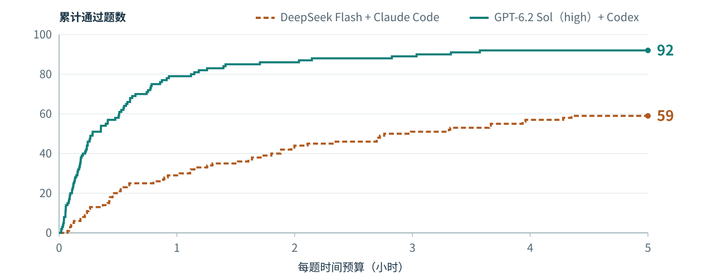

# Rocq 类型系统证明基准：初步评测报告

2026 年 11 月 27 日 · 草稿

我们想知道：面对编程语言（PL）研究中的问题，代码 Agent 能否完成研究者实际需要做的形式化证明？为此，我们先构建一个 benchmark。每道题提供一个包含目标定理的 Rocq 项目，Agent 需要补上证明，由 Rocq 检查。

## 从基础题到研究级题目

第一版由五个基础证明任务扩展成 [108 个变体](../README.md#benchmark-cases表)。提高时间预算后，DeepSeek Flash + Claude Code 已能稳定完成第一版中最难的题，因此我们转向研究级题目。

第二版从近十年的类型系统论文中选取重要定理，构建了 [100 道研究级题目](../benchmarks/research-pilot/README.md)。题目使用原作者的 Coq/Rocq 源码，覆盖类型安全、类型推断算法的正确性和可判定性、信息流安全等问题。

## 初步结果

原始结果 JSON：

- [DeepSeek Flash + Claude Code](https://github.com/zzhisthebest/PL-Paper-AutoProof/blob/1213cf780c96c8624312e0717f301f55dcd85055/benchmarkResults/research_pilot_deepseek_flash_cc_high_18000s/results_deepseek_flash_cc_high_18000s.json)
- [GPT‑6.2 Sol + Codex](../benchmarkResults/research_pilot/gpt62sol_codex_high_18000s/results_gpt62sol_codex_high_18000s.json)

## 接下来想讨论的问题

如何提高benchmark难度。
